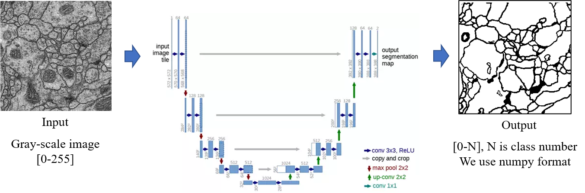
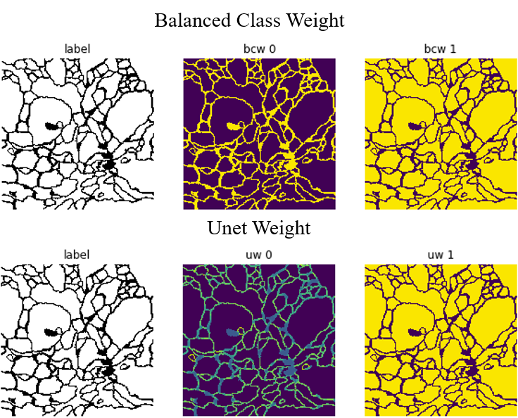
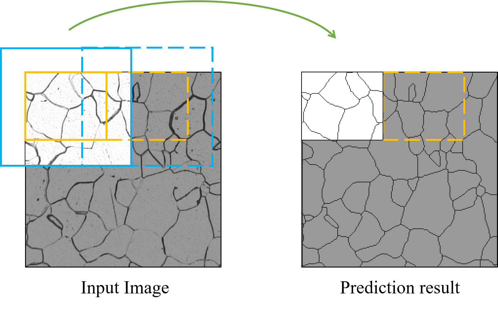
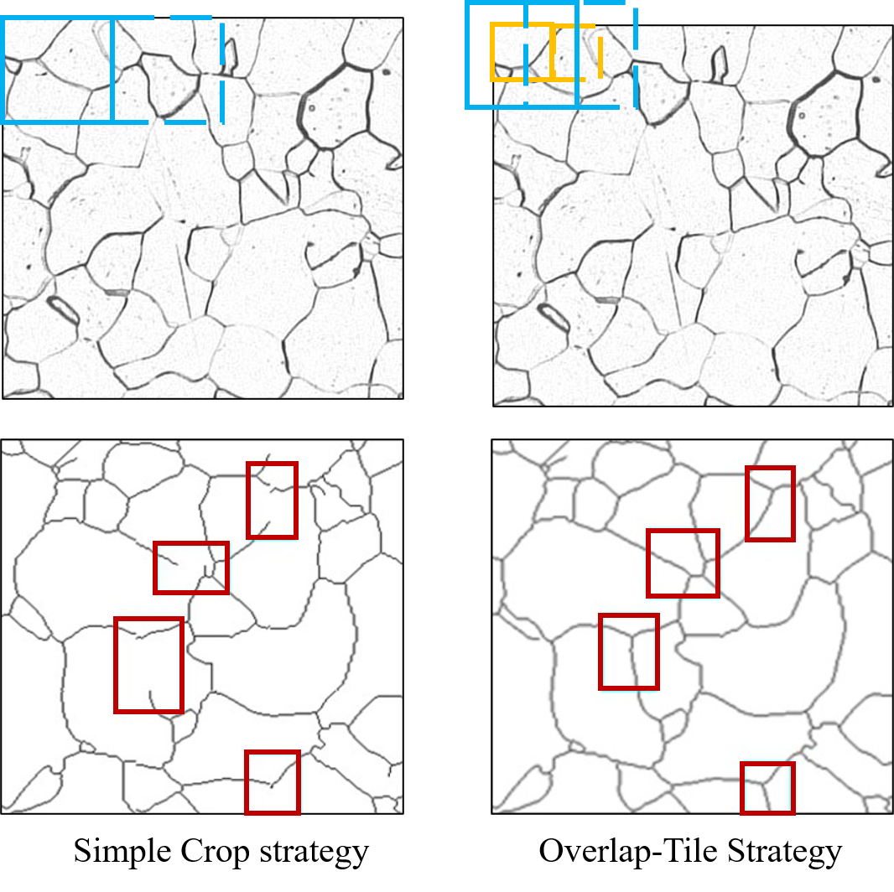

# The framework of image segmentation based on deep learning

This repository is aiming to build a framework of image segmentation based on deep learning. You can easily add your own data, augmentation method, network, loss function, metric and tta method during network training.

For example, we provide a demo with neural segmentation task in [ISBI2012 challange](http://brainiac2.mit.edu/isbi_challenge/).

## Main points

class SegTrainer: Control the whole processing of training, validation and inference.

class DataAugmentor: Control the data augmentation method during training, you can easily add your own method in this class.

class Losser: Control the loss function during training, you can easily add your own method in this class.

class NetInference: Control the inference (test) process, including test time augmentation, overlap tile strategy and post processing

class OverlapTile: Control the overlap-tile strategy during inference, please check the unet's paper

class TestTimeAug: Control the tta methods during inference, you can easily add your own method in this class.

Func get_metric: We provide 15 segmentation metrics in metrics.py and some details can be found at this [work](https://github.com/Keep-Passion/ImageSegMetrics).

Func data_preprocess: We define a format of data storage, you should change your own data according to required format.

Beside, we provide many designs in the code, such as cross validation, training log and many different implementations of unet weight map

## Requirement
All code are based on python36.  
Gala is installed according to https://github.com/janelia-flyem/gala. 

## Some explanation
### Weight map loss function
We can change the weight of specific pixel to change its importance during training process. In general, balanced class weight (bcw) is a classical weight map to solve class-imbalance problem.
And in this code, we provide bcw and unet's weight (uw).

### Overlap-tile strategy
To save the gpu assumption during inference, we can not feed whole image into network. So we must crop local image to analysis. Because of padding operation, simple crop strategy will cause
artifacts on the border. In this code, we provide an overlap-tile strategy, by feeding the network with local image in blue rectangle and only using result in yellow rectangle. 

The visualization of simple crop strategy and overlap-tile strategy is shown below:
